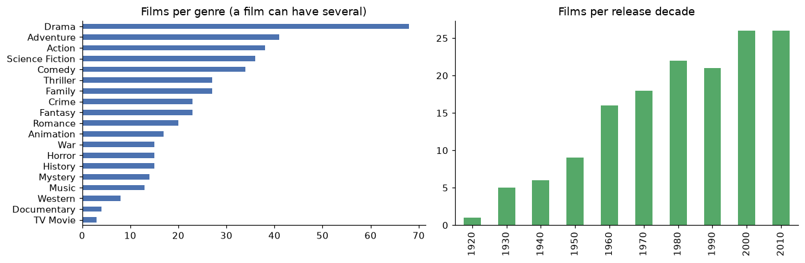
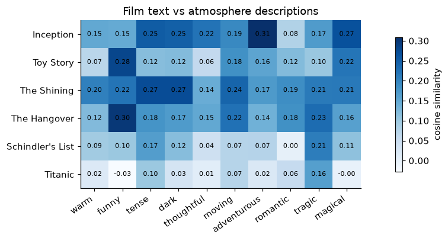
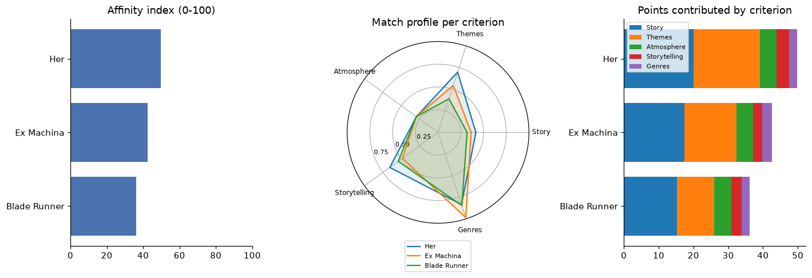
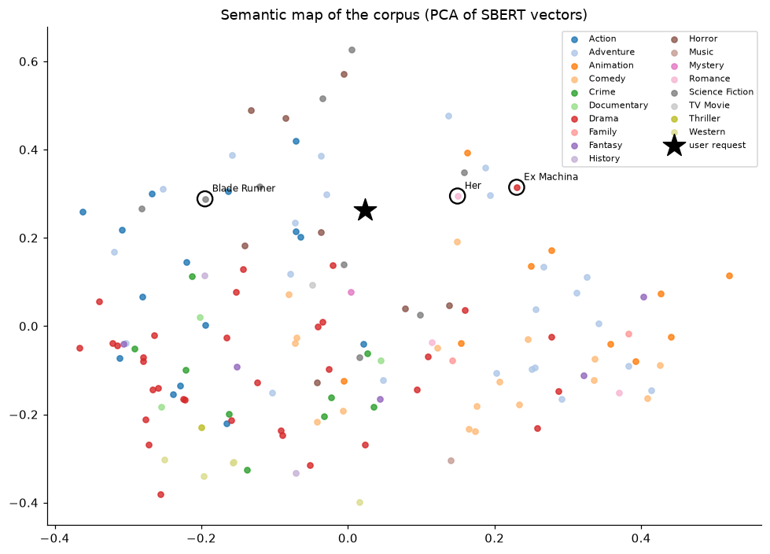
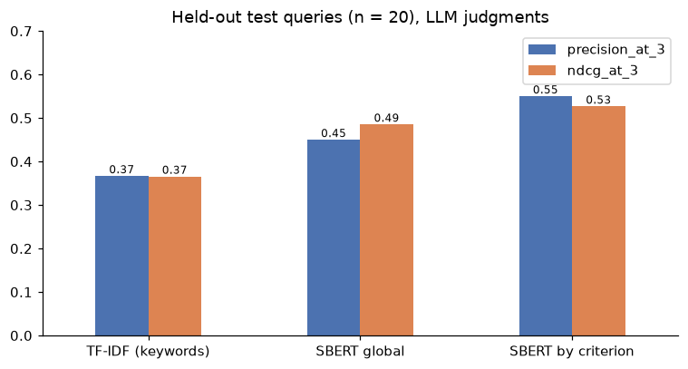

# Movie Match project documentation

This project implements an English movie recommendation application for the ING5 Natural Language Processing assignment. It matches a user's written expectations with a structured film corpus and explains the three highest-ranked recommendations.

The repository includes the interface and a corpus of 150 real films from the public TMDB 5000 snapshot. The setup instructions explain how to build the frontend and download the model once. Uvicorn then serves the interface and API locally without a personal API token. The technical checks cover application behaviour. Ranking quality was measured with automatic relevance judgments from a local language model; an independent human evaluation remains possible with the same protocol.

## Deliverables

The submission contains four parts. The source code is the web application (Python backend, React frontend) with comments at each processing step. The documented notebook notebooks/movie_match_walkthrough.ipynb runs the same backend modules step by step on the real corpus: dataset inspection, preprocessing, embeddings, the scoring formula computed by hand and checked against the engine, the Top 3 with explanations, the charts and the evaluation results. This PDF is the written documentation. The presentation slides support the class demonstration.

## Application architecture

The frontend uses React, TypeScript, Vite and Tailwind CSS. Recharts presents the global affinity and criterion scores. The backend uses Python 3.12, FastAPI and Pydantic. The REST API separates presentation from recommendation. NumPy handles vectors, scikit-learn provides the lexical comparison, and httpx collects source metadata.

GET /api/health reports corpus and local model availability. GET /api/catalog provides selectable genres, annotated topics and film identifiers. POST /api/recommend validates the questionnaire and returns the preference summary, ranked films, scoring details and warnings. Responses are stored in a structured format only with the user's consent: when the "Save my answers to the local study log" box is ticked, the API appends the answers, the method, the Top 3 with affinities and the corpus fingerprint as one JSON line in data/responses/responses.jsonl. A JSON export of the answers is also available after a search. POST /api/critic is the optional generative explanation described below.

## Questionnaire and user profile

The story description is required. Themes, atmosphere, narrative style, setting and preferred genres are optional. The questionnaire combines the question types requested by the assignment: open free-text questions (the story), guided text questions (themes, atmosphere, storytelling, setting), checkboxes (preferred and excluded genres), single-choice lists (release era and comparison method), multiple selections (excluded topics, films already watched) and Likert importance scales from 1 to 5 for each criterion. Empty optional answers represent no preference. The text answers carry the meaning; the structured answers only weight or filter them.

Release era, duration limits, excluded genres, excluded annotated topics and already watched films are separate from positive preferences. A genre cannot be both preferred and excluded. Unsupported non-English requests are rejected when language detection identifies them confidently. Very short or mixed-language input can remain ambiguous; the interface clearly asks for English.

## Reference corpus

The corpus contains 150 films from the public TMDB 5000 snapshot distributed on Kaggle by the dataset publisher. Selection balances genre and decade buckets and includes several well documented reference films. Titles, identifiers, overviews, genres, years, durations and keyword tags are source metadata. The manifest records the archive checksum, source URL and corpus fingerprint. The historical snapshot covers releases through 2016 and does not contain poster paths.

Themes use source keyword tags. Setting descriptions are extracted from explicit source cues. Atmosphere and narrative-focus labels are estimated by comparing source text with fixed English descriptions in the embedding space. A similarity below 0.15 leaves the label unknown. The evidence file records original tags, source setting cues and label similarities; no human cross-review is claimed. Pydantic validates all 150 records. Unknown values remain null, including 50 setting fields, 14 atmosphere fields and 4 narrative-style fields. The interface explains estimated attributes and missing-field handling.

---

## Semantic representation

The principal model is sentence-transformers/all-MiniLM-L6-v2. It maps English sentences and short paragraphs to 384-dimensional vectors. It is used as a pretrained encoder on CPU. No task-specific model training is performed.

Cleaning only normalises whitespace. It preserves negations, punctuation and sentence context. Text longer than the supported sequence length is split into token chunks with room reserved for special tokens. Chunk vectors are averaged and normalised. The same procedure encodes user preferences and film attributes.

The model was chosen because requests and film descriptions are sentences rather than isolated words. Static word embeddings such as Word2Vec, GloVe or fastText average word vectors and lose context and word order, while Sentence-BERT is trained so that paraphrases receive close vectors. In the notebook, "A film about a robot that develops feelings" and "An artificial intelligence learns to love" share no content word (TF-IDF cosine 0.00) but reach an SBERT cosine of 0.57. The model is also small enough to answer in under 50 ms on a laptop CPU, and its normalised vectors make cosine similarity a dot product. Cosine similarity compares directions rather than lengths, so a long synopsis is not favoured over a short label.

The model is downloaded during preparation and stored locally. Corpus vectors are cached using text content, model files and processing settings. User text is not written to the disk cache. Model and corpus preparation are separate from recommendation, so no TMDB request or model download is needed during the demonstration.

## Scoring method

Each active user criterion is compared with the corresponding film field by cosine similarity. The free story description is compared with the whole film profile (synopsis, keyword themes, atmosphere, storytelling, setting and genres in one text), because users naturally mix plot, tone and genre in that answer. The other criteria are compared with their own field only. This choice was selected on the validation queries (see the evaluation section). The initial base weights are story 0.35, themes 0.25, atmosphere 0.15, narrative style 0.10, setting 0.10 and genres 0.05. An importance value from 1 to 5 multiplies each base weight.

For a film f, let A(f) be the set of criteria both supplied by the user and available for that film. For criterion b, let w(b) be its base weight, i(b) its importance, and s(b,f) its cosine similarity. The score is:

Affinity(f) = 100 * sum[w(b) * i(b) * max(0, s(b,f))] / sum[w(b) * i(b)], for b in A(f).

If no usable criterion remains, the film is not scored. Missing fields are reported, and weights are renormalised over available active criteria. This can make a film with fewer annotations look strong on fewer criteria; the displayed missing-field warning and final corpus completeness check are therefore important.

This formula is the weighted coverage score suggested by the assignment, sum(Wi * Si) / sum(Wi), where the criteria play the role of the competency blocks, Wi is the base weight multiplied by the Likert importance and Si is the cosine similarity. The base weights follow the information value and reliability of each field: the synopsis is always present and the richest text, keyword themes are precise and present for every film, atmosphere is an estimated label, storytelling and setting are secondary or often missing, and genres are coarse and already handled by the strict genre filter.

Worked example from the notebook: for the assignment request about an emotional science-fiction film on human relationships and artificial intelligence, Her obtains story 0.42, themes 0.70, atmosphere 0.30, storytelling 0.66 and genres 0.84. With the chosen importances the weighted sum is 1.817 over a total weight of 3.65, so the affinity is 49.8. The engine returns the same value.

The affinity index ranges from 0 to 100. It expresses textual alignment, not a calibrated probability of enjoyment. The initial weights are design assumptions that should be checked on the validation queries.

## Filters and explanations

Strict filters are applied before ranking. A duration limit excludes unknown durations. Excluded genres and already watched identifiers are removed. Topic exclusions match reviewed tags and exclude films with unknown topic annotations. They cannot guarantee that every scene avoids a topic. If fewer than three eligible films remain, the response explains this without relaxing a constraint.

The result includes film metadata, the global index, criterion similarities, normalised weights, point contributions and source attribute text. The two largest positive contributions support a deterministic explanation. No positive match and missing annotations are shown explicitly. Three charts support interpretation: a bar chart of the global affinity, a radar chart of the match profile (similarity per criterion for each of the three films) and a grouped bar chart per criterion. Posters are cached separately from public TMDB pages with their image sources recorded. Both posters and typography are served locally for offline use.

The cinema interface provides mood shortcuts that guide optional preferences while preserving an existing story and strict limits. A searchable collection supports accent-insensitive title searches. The mobile action keeps search accessible while completing the questionnaire. The dark layout, poster cards, reduced-motion support and expanded scoring details keep the same recommendation logic visible to the user.

---

## Evaluation protocol

The comparison has three methods: TF-IDF with cosine similarity, SBERT with one global text embedding, and SBERT with criterion-level aggregation. All methods use the same corpus and strict filters. The lexical method is a reference for checking whether semantic representations help beyond shared vocabulary. The global method tests the value of criterion-level organisation.

The project provides 30 English requests: 10 validation queries for parameter selection and 20 held-out test queries. The queries include paraphrases, multiple expectations, difficult requests and strict constraints. A pooling command gathers the union of the Top 10 from the three methods for each query.

Annotators judge candidates from 0 to 3. Two independent annotators are preferred. Their available judgments are averaged; a value of at least 2 counts as relevant. Precision@3 uses a denominator of three. nDCG@3 uses exponential gains and the ideal order within the common judged pool. Constraint compliance and the number of returned films are reported, as well as warm search latency.

The evaluator rejects unfinished judgments and mismatched corpus fingerprints. Pooling is not exhaustive relevance assessment. The small test set limits conclusions and should be discussed alongside errors and qualitative examples. No relevance measurements are invented: the results below are explicitly labelled as automatic LLM judgments.

## Evaluation results

Human annotators were not available, so the pooled candidates were judged by a local language model (qwen3:14b through Ollama, temperature 0) with the same 0 to 3 scale. The judge only receives source metadata (title, year, runtime, genres, TMDB keywords and synopsis) and may use its general knowledge of the film. It never sees our estimated atmosphere or storytelling labels, so it cannot favour the criterion method by construction. 607 query-film pairs were judged. These are automatic "silver" judgments: they can share biases with the embedding model and they are not a substitute for human relevance assessment.

The scoring configuration was chosen on the 10 validation queries only. Two ideas were compared: what the story description is compared with (the synopsis alone, or the whole film profile) and whether to add an extra "overall profile" criterion with a share of 0, 25 or 50 percent of the affinity.

| Story compared with | Overall share | Validation P@3 | Validation nDCG@3 |
| --- | ---: | ---: | ---: |
| Synopsis | 0% | 0.500 | 0.498 |
| Synopsis | 25% | 0.567 | 0.521 |
| Synopsis | 50% | 0.567 | 0.527 |
| Whole profile | 0% | 0.567 | 0.574 |
| Whole profile | 25% | 0.533 | 0.558 |
| Whole profile | 50% | 0.533 | 0.544 |

Comparing the story with the whole profile and no extra criterion gave the best result on both metrics and is also the simplest option, so it became the default. The 20 test queries were then used once to compare the three methods:

| Method | Test P@3 | Test nDCG@3 | Validation P@3 | Validation nDCG@3 | Warm latency |
| --- | ---: | ---: | ---: | ---: | ---: |
| TF-IDF (keywords) | 0.367 | 0.366 | 0.533 | 0.475 | 42 ms |
| SBERT, one global vector | 0.450 | 0.485 | 0.533 | 0.527 | 46 ms |
| SBERT by criterion (selected) | 0.550 | 0.527 | 0.567 | 0.580 | 47 ms |

All methods respected every strict constraint. On the held-out test queries the semantic methods clearly beat the keyword baseline, and the criterion-level aggregation adds about 10 points of Precision@3 over a single global embedding. For transparency, the previous configuration (story compared with the synopsis only) reached 0.450 P@3 and 0.433 nDCG@3 on the same test queries. With 20 queries one relevant film more or less changes P@3 by about 1.7 points, so the differences are indicative rather than statistically established. The per-query results are in evaluation/results-llm-test.json and the judge's one-sentence reasons are in evaluation/judgments-llm.csv for manual inspection.

Typical errors remain. A broad comedy can rank high for a family request because the atmosphere words match ("funny", "light"), even though the film is not suitable for children. Requests mixing several expectations can be dominated by the criterion with the clearest wording. Negations inside positive fields are not understood by the encoder, which is why exclusions are separate filters.

## Optional generative explanation

As a bonus, each recommendation can show an "Ask the critic" button when a local Ollama server is running. A small language model (qwen3:8b by default) receives the preference summary, the synopsis and the two strongest matching criteria, and writes two or three sentences explaining the match. It is told not to invent plot details or awards. The ranking never depends on this model: it only rephrases a decision already computed by the semantic scorer, and the interface labels the text as machine-written. Without Ollama the button is hidden and the application stays fully offline.

## Verification and remaining work

Automated tests cover score aggregation, missing-field renormalisation, priorities, strict filters, unknown durations, contradictions, unsupported language, ranking metrics and API responses. Frontend tests cover request construction, contradictory genres and missing-corpus behaviour. Production compilation checks TypeScript and the Vite build. Semantic integration checks use the real local encoder with fictional fixtures, which are separate from the film corpus.

The ready-to-run technical check submits all 30 requests to each of the three methods on the real 150-film corpus. All 90 searches respected strict constraints, score bounds and ranking order. Average warm search times in this local run on an Apple Silicon laptop were 42 ms for TF-IDF, 46 ms for global SBERT and 47 ms for criterion SBERT. These timings describe one machine and run; they are not relevance scores.

The main remaining work is a human relevance study with the same pooling protocol, ideally with two annotators, to confirm the automatic judgments and measure agreement between humans and the LLM judge. A factual cross-review of the estimated atmosphere and storytelling labels would also improve the corpus. Every member should take part in the class presentation and demonstration.

## Sources

Course assignment: Sarah Malaeb, Natural Language Processing project, ECE ING5 Data and AI, 2026-2027, pages 8-9, 15-16 and 19.

TMDB API and attribution: https://developer.themoviedb.org/docs/faq

Public metadata snapshot: https://www.kaggle.com/datasets/tmdb/tmdb-movie-metadata

Model description: https://huggingface.co/sentence-transformers/all-MiniLM-L6-v2

FastAPI documentation: https://fastapi.tiangolo.com/

Sentence Transformers documentation: https://www.sbert.net/
